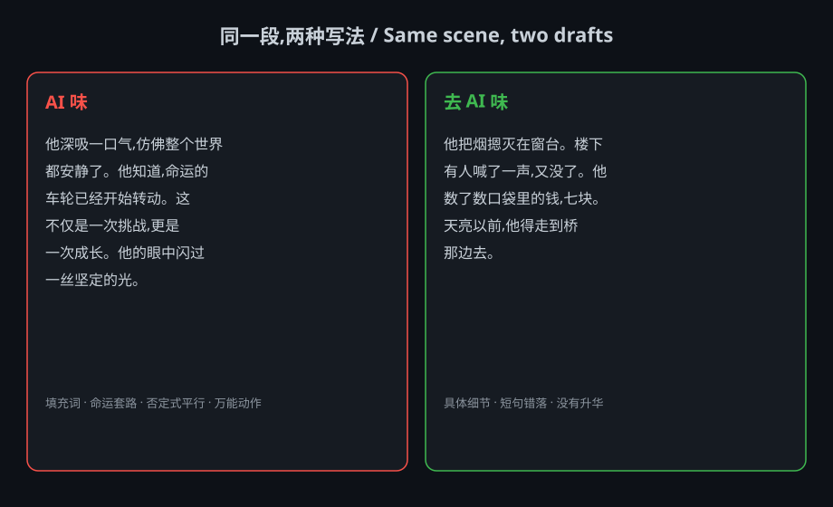

# novel-script-writer

A universal literary-writing skill for Claude Code. Write novels, web fiction, short stories, and AI short-drama scripts in any genre, any style, and any language — with the AI-flavor stripped out and the literary craft put back in.

<p align="center"></p>

## Why this exists

LLMs write prose that is grammatically flawless and stylistically dead. Same sentence rhythms, same filler words, same "not X but Y" constructions, same three-part lists. Ask an LLM to imitate an author and you get a costume, not a fingerprint.

This skill fixes both problems:

1. **De-AI** — it targets *structural* tells that survive model updates, not word lists that go stale the moment a new model ships.
2. **Style** — it ships a distillation method that turns any sample of real writing into a reusable "style card", so the skill writes *like the author*, not *about the author*.

## What it does

- **On-demand outputs** — worldbuilding, outline, full novel, or AI short-drama script. Only what you ask for, nothing bolted on.
- **De-AI flavor** — removes filler, cliché gestures, "not X but Y", forced triads, and meaningless elevation, per language. Bundled `scripts/deai-check.py` scans any draft and flags the candidate tells before you edit.
- **Style distillation (feed-text)** — feed a few chapters and it extracts a 9-axis fingerprint with real anchor sentences, then writes and rewrites in that voice. Feed enough authors and it becomes a generalist: any style, on demand.
- **Long-form continuity** — a serial-state template (characters, foreshadowing, timeline, world rules, chapter hooks) that keeps a 50-chapter novel from contradicting itself, plus a hook taxonomy (5 types) and a pacing/追读力 self-review for web fiction and short drama.
- **Multilingual literary writing** — 10 languages (English, Spanish, French, Italian, German, Russian, Japanese, Arabic, Hebrew, Chinese), each with its own AI-tell list, literary norms, and positive literary devices anchored in real public-domain classics.
- **Literary translation** — 信达雅 (faithful → fluent → elegant), with the target language's de-AI rules applied to the translation too.
- **Image & video prompts** — turns characters, scenes, covers, and short-drama shots into structured text-to-image / text-to-video prompts (即梦 / Midjourney / 可灵 / Stable Diffusion / Runway / Sora): one subject per prompt, concrete nouns over abstract adjectives.
- **Word export** — `scripts/novel2docx.py` for Chinese novel typography (2-char first-line indent, justified, 1.5 line spacing).

## Install

```bash
mkdir -p ~/.claude/skills
cp -r novel-script-writer ~/.claude/skills/
```

Then just ask Claude to write something. The skill triggers on requests to write or generate novels, stories, scripts, imitate an author's style, feed writing samples, or do multilingual literary work.

## Usage

```
写一个中式玄幻短篇，5000 字，第三人称，主角叫林风，先给大纲再写正文
```

```
模仿《龙族》的文笔写一段雨夜独白
```

```
Write this scene in English, no AI-slop, then give me the Chinese translation.
```

```
写一个 3 分钟 AI 短剧剧本，每个镜头附通用视频提示词，对话用英文、旁白用中文
```

For the style-imitation ones: feed real text first. The skill distills it into a style card, then writes in that voice.

## Examples

What the prompt generator produces — one subject, concrete nouns, layered fields, adapted per tool.

**Character portrait (text-to-image)** — a fantasy swordswoman

即梦 / 可灵 (Chinese, ready to paste):

> 二十岁左右的女剑修,银白长发高束,红边白衣,腰悬细剑,站在山崖边回眸,衣袂被风吹起;云海翻涌的仙山,晨雾弥漫;冷白晨光从侧后方打来;半身、微仰视、浅景深;国风水墨厚涂;高清细节,比例 3:4

Midjourney (English):

> a female sword cultivator in her early twenties, long silver-white hair in a high ponytail, white hanfu with red trim, a slender sword at her waist, standing on a cliff edge looking back, robes billowing in the wind, misty immortal mountains with a sea of clouds, cold morning light from behind, waist-up, slight low angle, shallow depth of field, Chinese ink-wash thick paint style, highly detailed --ar 3:4 --style raw --v 6

**Scene concept (text-to-image)** — cyberpunk street, Stable Diffusion positive + negative:

> positive: (masterpiece, best quality:1.2), cyberpunk city street at night, neon signs, rain-slick road with reflections, a lone figure with an umbrella seen from behind, wide shot, cinematic lighting, highly detailed
>
> negative: (worst quality, low quality:1.4), bad anatomy, extra fingers, deformed, blurry, text, watermark, signature

**Short-drama shot (text-to-video)** — a man smoking on a rainy alley

可灵 / 即梦 (Chinese):

> 中近景,缓慢推近。深夜城中村巷口,雨后路面反光。一个穿旧灰夹克的男人蹲在路边,慢慢把烟送到嘴边,烟头明灭。眉头微皱,眼神放空。冷青色路灯从头顶打下,脸一半在光里一半在阴影里,背景有车灯扫过。压抑、写实、电影质感,约 4 秒。

Runway / Sora (English):

> Medium close-up, slow push-in. Late-night alley in an urban village, wet ground reflecting light after rain. A man in an old gray jacket crouches by the roadside, slowly raising a cigarette to his lips, the ember glowing. Furrowed brows, vacant stare. Cold cyan streetlight from above, half his face in light, half in shadow, car headlights sweeping past in the background. Oppressive, realistic, cinematic, about 4 seconds.

**Complete short stories** — the skill also writes finished fiction. Two sample suspense/horror stories, one in each language:

- [examples/suspense-horror-zh.md](examples/suspense-horror-zh.md) — 《第八十四级台阶》
- [examples/suspense-horror-en.md](examples/suspense-horror-en.md) — *Three Seconds Late*

Both samples scan clean with the bundled `scripts/deai-check.py`: 0 filler words, 0 cliché gestures, 0 "not X but Y", 0 triads. The sentence-length spread (中文 9.4 / English 10.9 stddev) is exactly the bursty rhythm the de-AI layer targets.

## How the style distillation works

Nine axes — sentence & punctuation, paragraphing, vocabulary, dialogue, point of view, imagery, emotional intensity, rhythm & structure, and forbidden moves. Three rules carry it:

- **Rules lie, anchor sentences don't.** Every axis must carry 2–3 verbatim sentences from the sample. Rules go abstract; anchors pull you back to the actual voice.
- **Three times makes a signal.** A trait that appears once is improvisation; in three places it's a signature.
- **Spice is not a formula.** Signature moves are tools, not a checklist. A short scene uses one or two, never all of them.

The blank template lives in `style-cards/_template.md`. Your own distilled cards stay local — the repo ships no specific author's card, so it's style-agnostic by design. Want a given author's voice? Feed their text.

## Multilingual, anchored in real classics

Each language entry has: literary norms → AI tells → countermeasures → positive literary devices, each device anchored in a verbatim sentence from a public-domain classic:

| Language | Anchor source |
|---|---|
| English | *Wuthering Heights*, *Jane Eyre*, *Pride and Prejudice* |
| Spanish | *Don Quijote* |
| French | *Madame Bovary* |
| Italian | *I promessi sposi* |
| German | *Die Leiden des jungen Werther* |
| Japanese | 太宰治『人間失格』, 夏目漱石『こころ』 |
| Russian | *Anna Karenina* (opening) |

## Structure

```
novel-script-writer/
├── SKILL.md                          # workflow + writing rules (the core)
├── references/
│   ├── ai-flavor-avoidance.md        # Chinese de-AI checklist
│   ├── style-distillation.md         # 9-axis style fingerprint method
│   ├── serial-state.md               # long-form continuity template
│   ├── multilingual-writing.md       # per-language literary norms + devices
│   ├── multilingual-typography.md    # punctuation / indent / RTL rules
│   ├── genre-playbook.md             # genre essentials (suspense / romance / scifi / ...)
│   ├── hooks-rhythm.md               # chapter hooks (5 types) + pacing / 追读力 review
│   ├── video-prompt-format.md        # structured prompts for video-gen AI
│   └── image-prompt-format.md        # structured text-to-image prompts (covers / characters / scenes)
├── scripts/
│   ├── deai-check.py                 # AI-flavor scanner (zh/en/fr/es/de/ja)
│   └── novel2docx.py                 # Markdown → .docx with novel typography
└── style-cards/
    ├── README.md
    └── _template.md                  # blank style-card template
```

## License

MIT
